<h1 align="center">
  <picture>
    <source media="(prefers-color-scheme: dark)" srcset=".github/readme-header-96-brand-cream.svg">
    
  </picture>
</h1>

Logos, guidelines, and templates for Ninety Six High School athletics, clubs, and school spirit.

**Start here: [Brand Guidelines v1.2 (PDF)](guidelines/Wildcats_Brand_Guidelines_v1.2.pdf)**. It's 19 pages, 8.5 x 11 in, and covers which logo to use, sizes, colors, fonts, templates, and rules.

## Logos

Every logo comes in **maroon, cream, black, and white**, in three formats:

- **SVG** for websites, Canva, Google Slides, and vendors
- **PDF** for printing, sign shops, and apparel vendors
- **PNG** (transparent background) for documents, slides, and social media

To download one file, open it on GitHub and click the download button. To get everything, use **Code → Download ZIP** at the top of this page.

| Logo | Use |
|---|---|
| <picture><source media="(prefers-color-scheme: dark)" srcset="logos/primary/wildcats-primary-cream.svg">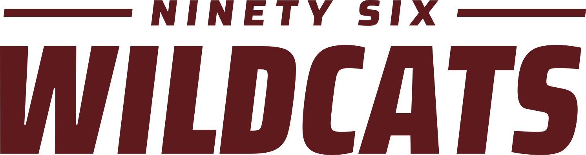</picture> | **Primary**<br>TV slides, posters, signs, back of shirts<br>Minimum: 1.5 in / 240 px<br>[`logos/primary/`](logos/primary/) |
| <picture><source media="(prefers-color-scheme: dark)" srcset="logos/horizontal/wildcats-horizontal-cream.svg">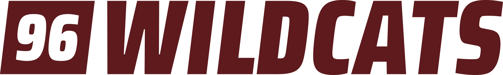</picture> | **Horizontal**<br>Narrow or small spaces, web headers, letterhead, merchandise<br>Minimum: 1 in / 110 px<br>[`logos/horizontal/`](logos/horizontal/) |
| <picture><source media="(prefers-color-scheme: dark)" srcset="logos/stacked/wildcats-stacked-cream.svg">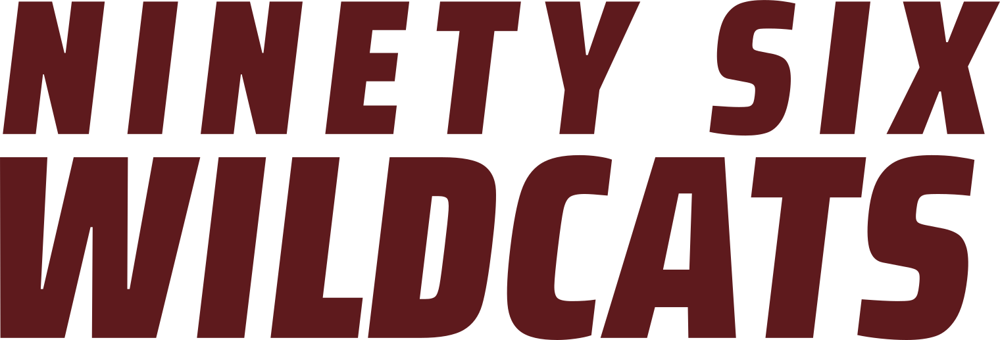</picture> | **Stacked**<br>Square spaces, social posts<br>Minimum: 1 in / 140 px<br>[`logos/stacked/`](logos/stacked/) |
| <picture><source media="(prefers-color-scheme: dark)" srcset="logos/wordmark/wildcats-wordmark-cream.svg"></picture> | **Wordmark**<br>When 96 already appears nearby<br>Minimum: 0.8 in / 80 px<br>[`logos/wordmark/`](logos/wordmark/) |
| <picture><source media="(prefers-color-scheme: dark)" srcset="logos/icon/wildcats-icon-cream.svg">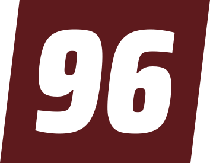</picture> | **Icon**<br>Profile pictures, favicons, sleeves, left chest<br>Minimum: 0.3 in / 32 px<br>[`logos/icon/`](logos/icon/) |

### Ninety Six High School (official use)

<picture><source media="(prefers-color-scheme: dark)" srcset="logos/institutional/ninetysix-hs-stacked-cream.svg">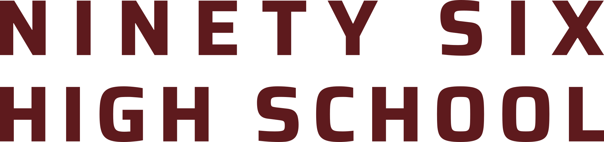</picture>

For official letters, forms, academic material, and graduation, use the plain school mark in [`logos/institutional/`](logos/institutional/), not the athletic WILDCATS logos.

### Teams and clubs

Each team folder has a horizontal logo and a square logo in all four colors and three formats. Every team also has a ready-made profile picture in [`social/profile/teams/`](social/profile/teams/).

| | |
|---|---|
| <picture><source media="(prefers-color-scheme: dark)" srcset="logos/teams/athletics/wildcats-team-athletics-horizontal-cream.svg">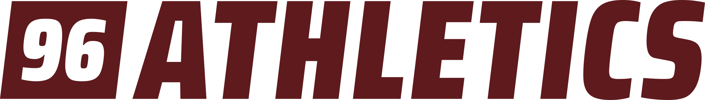</picture><br>[Athletics](logos/teams/athletics/) | <picture><source media="(prefers-color-scheme: dark)" srcset="logos/teams/football/wildcats-team-football-horizontal-cream.svg">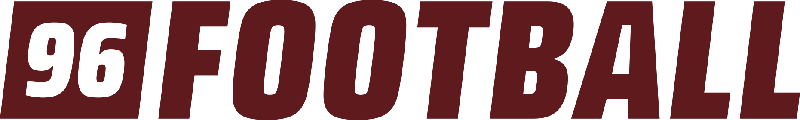</picture><br>[Football](logos/teams/football/) |
| <picture><source media="(prefers-color-scheme: dark)" srcset="logos/teams/soccer/wildcats-team-soccer-horizontal-cream.svg">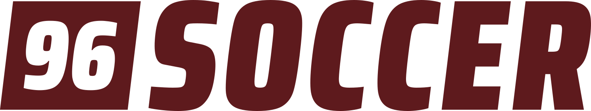</picture><br>[Soccer](logos/teams/soccer/) | <picture><source media="(prefers-color-scheme: dark)" srcset="logos/teams/basketball/wildcats-team-basketball-horizontal-cream.svg"></picture><br>[Basketball](logos/teams/basketball/) |
| <picture><source media="(prefers-color-scheme: dark)" srcset="logos/teams/baseball/wildcats-team-baseball-horizontal-cream.svg">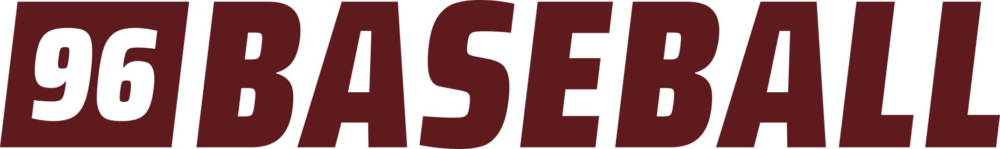</picture><br>[Baseball](logos/teams/baseball/) | <picture><source media="(prefers-color-scheme: dark)" srcset="logos/teams/softball/wildcats-team-softball-horizontal-cream.svg">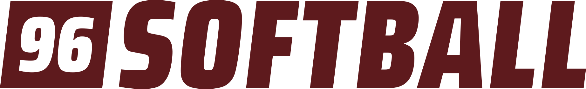</picture><br>[Softball](logos/teams/softball/) |
| <picture><source media="(prefers-color-scheme: dark)" srcset="logos/teams/volleyball/wildcats-team-volleyball-horizontal-cream.svg">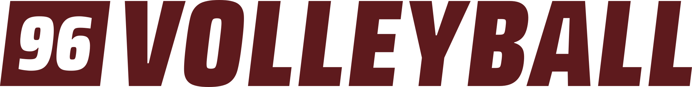</picture><br>[Volleyball](logos/teams/volleyball/) | <picture><source media="(prefers-color-scheme: dark)" srcset="logos/teams/wrestling/wildcats-team-wrestling-horizontal-cream.svg">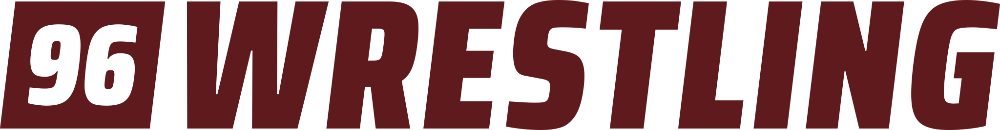</picture><br>[Wrestling](logos/teams/wrestling/) |
| <picture><source media="(prefers-color-scheme: dark)" srcset="logos/teams/golf/wildcats-team-golf-horizontal-cream.svg">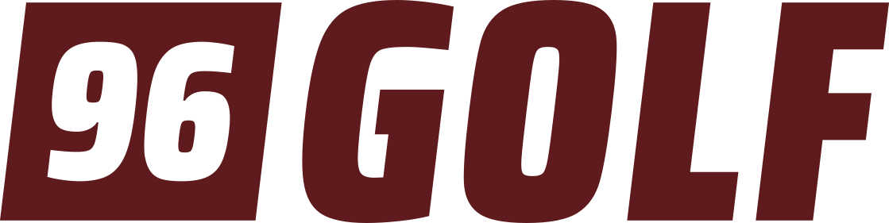</picture><br>[Golf](logos/teams/golf/) | <picture><source media="(prefers-color-scheme: dark)" srcset="logos/teams/cheer/wildcats-team-cheer-horizontal-cream.svg">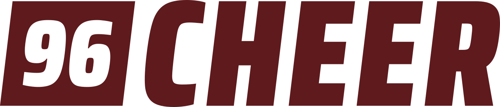</picture><br>[Cheer](logos/teams/cheer/) |
| <picture><source media="(prefers-color-scheme: dark)" srcset="logos/teams/cross-country/wildcats-team-cross-country-horizontal-cream.svg">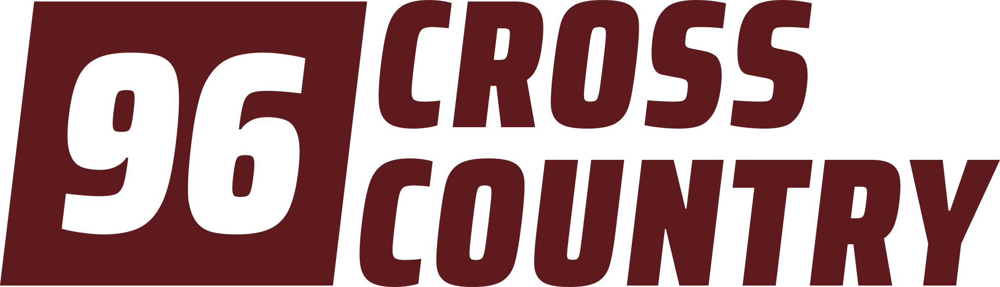</picture><br>[Cross Country](logos/teams/cross-country/) | <picture><source media="(prefers-color-scheme: dark)" srcset="logos/teams/track-and-field/wildcats-team-track-and-field-horizontal-cream.svg">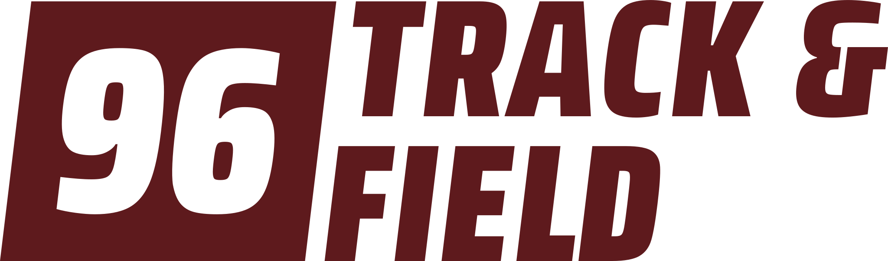</picture><br>[Track & Field](logos/teams/track-and-field/) |
| <picture><source media="(prefers-color-scheme: dark)" srcset="logos/teams/band/wildcats-team-band-horizontal-cream.svg"></picture><br>[Band](logos/teams/band/) | <picture><source media="(prefers-color-scheme: dark)" srcset="logos/teams/marching-band/wildcats-team-marching-band-horizontal-cream.svg">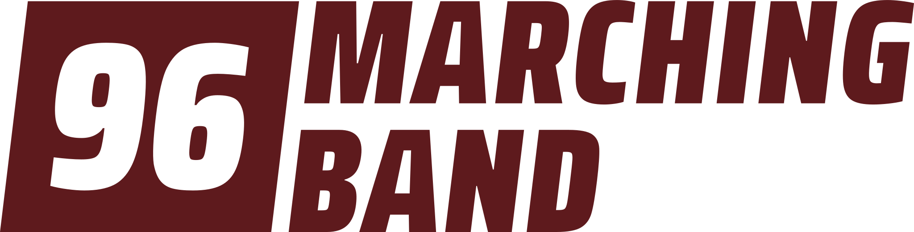</picture><br>[Marching Band](logos/teams/marching-band/) |
| <picture><source media="(prefers-color-scheme: dark)" srcset="logos/teams/indoor-percussion/wildcats-team-indoor-percussion-horizontal-cream.svg">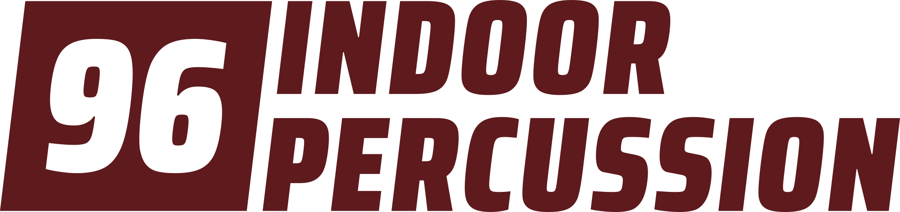</picture><br>[Indoor Percussion](logos/teams/indoor-percussion/) | <picture><source media="(prefers-color-scheme: dark)" srcset="logos/teams/drama/wildcats-team-drama-horizontal-cream.svg"></picture><br>[Drama](logos/teams/drama/) |
| <picture><source media="(prefers-color-scheme: dark)" srcset="logos/teams/student-council/wildcats-team-student-council-horizontal-cream.svg">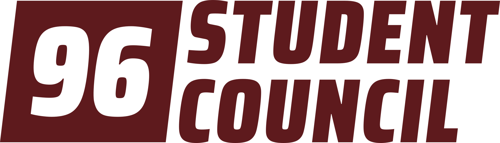</picture><br>[Student Council](logos/teams/student-council/) | <picture><source media="(prefers-color-scheme: dark)" srcset="logos/teams/sga/wildcats-team-sga-horizontal-cream.svg">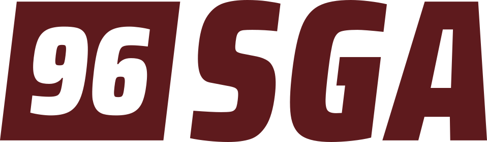</picture><br>[SGA (Student Government)](logos/teams/sga/) |
| <picture><source media="(prefers-color-scheme: dark)" srcset="logos/teams/academic-team/wildcats-team-academic-team-horizontal-cream.svg">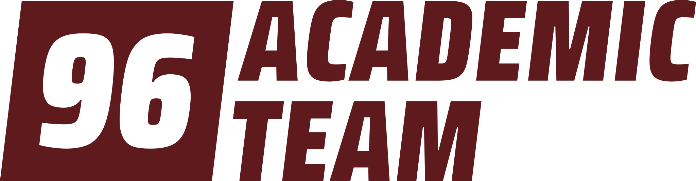</picture><br>[Academic Team](logos/teams/academic-team/) | <picture><source media="(prefers-color-scheme: dark)" srcset="logos/teams/beta-club/wildcats-team-beta-club-horizontal-cream.svg">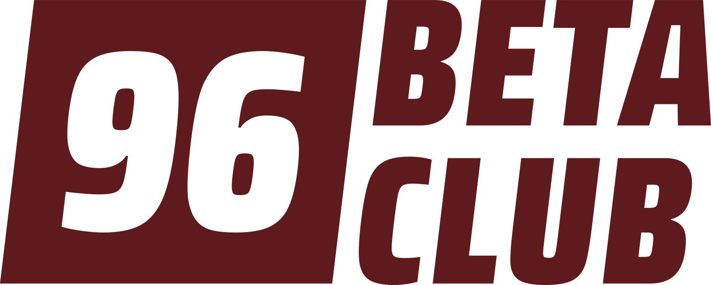</picture><br>[Beta Club](logos/teams/beta-club/) |
| <picture><source media="(prefers-color-scheme: dark)" srcset="logos/teams/nhs/wildcats-team-nhs-horizontal-cream.svg"></picture><br>[NHS (National Honor Society)](logos/teams/nhs/) | <picture><source media="(prefers-color-scheme: dark)" srcset="logos/teams/nehs/wildcats-team-nehs-horizontal-cream.svg">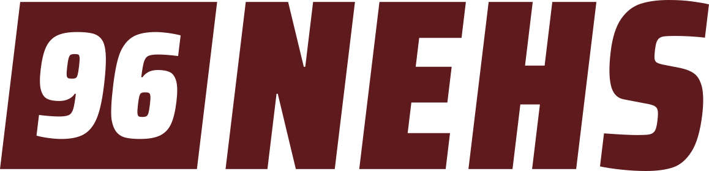</picture><br>[NEHS (National English Honor Society)](logos/teams/nehs/) |
| <picture><source media="(prefers-color-scheme: dark)" srcset="logos/teams/nths/wildcats-team-nths-horizontal-cream.svg">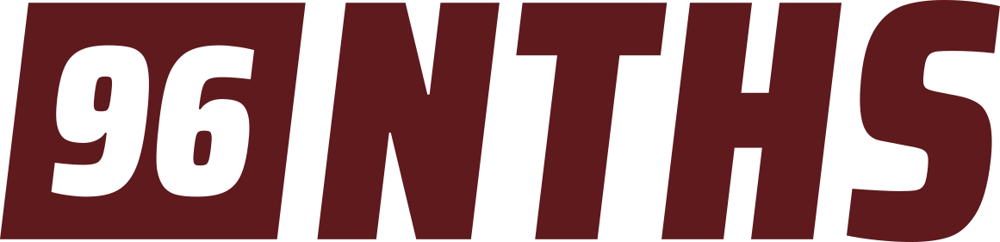</picture><br>[NTHS (National Technical Honor Society)](logos/teams/nths/) | <picture><source media="(prefers-color-scheme: dark)" srcset="logos/teams/fca/wildcats-team-fca-horizontal-cream.svg">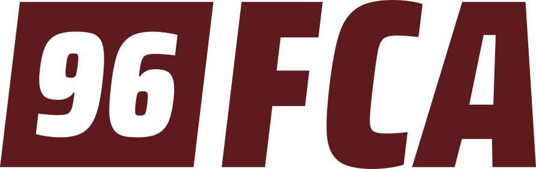</picture><br>[FCA (Fellowship of Christian Athletes)](logos/teams/fca/) |
| <picture><source media="(prefers-color-scheme: dark)" srcset="logos/teams/ffa/wildcats-team-ffa-horizontal-cream.svg"></picture><br>[FFA](logos/teams/ffa/) | <picture><source media="(prefers-color-scheme: dark)" srcset="logos/teams/fishing-team/wildcats-team-fishing-team-horizontal-cream.svg">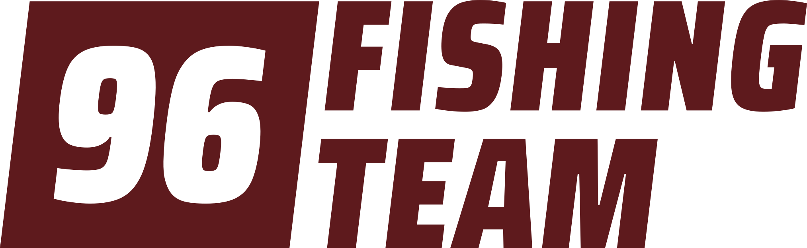</picture><br>[Fishing Team](logos/teams/fishing-team/) |
| <picture><source media="(prefers-color-scheme: dark)" srcset="logos/teams/shooting-club/wildcats-team-shooting-club-horizontal-cream.svg">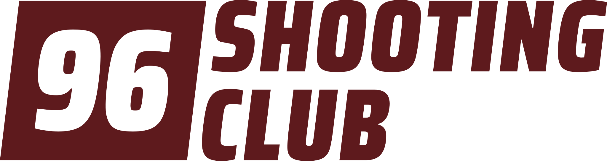</picture><br>[Shooting Club](logos/teams/shooting-club/) |  |

To add a team or club, see [Adding a team](#adding-a-team).

## Other files

| Folder | Contents |
|---|---|
| [`social/profile/`](social/profile/) | 1080 x 1080 profile pictures for circular crops: the 96 alone for the main account, and one per team |
| [`templates/social/`](templates/social/) | Social media: five post layouts (announcement, photo, game or event, result, schedule) and a story, each with examples and a `blank`, plus editable PowerPoint files |
| [`templates/`](templates/) | TV slide, 11 x 17 poster, letterhead, and a T-shirt concept. Each has an `example` and a `blank` background for adding your own text in Canva or Slides. |
| [`production-tests/`](production-tests/) | Minimum-size test sheets for screens, print, screen printing, vinyl, and embroidery |
| [`guidelines/`](guidelines/) | The guidelines PDF, each page as an image, and the [audits](guidelines/audit.md) with before/after comparisons |
| [`fonts/`](fonts/) | Saira and Saira Condensed Black, free under the SIL Open Font License |
| [`source/`](source/) | Scripts that build every file in this repository |

## File names

| Files | Pattern |
|---|---|
| Wildcats logos | `wildcats-<logo>-<color>.svg` (also `.pdf` and `.png`) |
| Team logos | `wildcats-team-<team>-<horizontal or square>-<color>.svg` |
| School mark | `ninetysix-hs-<line or stacked>-<color>.svg` |
| Profile pictures | `wildcats-profile-<variant>.png` |
| Templates | `wildcats-<template>-<example or blank>.png` |
| Social templates | `wildcats-social-<layout>-<example or blank>.png`, `wildcats-social-posts.pptx`, `wildcats-social-stories.pptx` |

Colors are `maroon`, `cream`, `black`, and `white`. Team names are lowercase with hyphens (`cross-country`, `track-and-field`).

## Colors

| | HEX | RGB |
|---|---|---|
| Maroon | `#5E1A1D` | 94, 26, 29 |
| Cream | `#F5EAD5` | 245, 234, 213 |
| TV gradient, top | `#973333` | 151, 51, 51 |
| TV gradient, bottom | `#320B0B` | 50, 11, 11 |

CMYK and Pantone values haven't been set yet. They should be matched by a printer against a physical proof before the first large print or apparel order.

## Making a social post

Posts are 1080 x 1350 px and stories are 1080 x 1920 px. Pick the layout that fits the message:

| Layout | Use for |
|---|---|
| Announcement | Spirit Week, schedule changes, reminders, school and academic events |
| Photo | When the photo is the story: senior nights, thank-yous, staff and team features |
| Game or event | Game day, homecoming, concerts, competitions |
| Result | Final scores |
| Schedule | A season or a list of dates |
| Story | Any of the above as an Instagram or Facebook story |

The easiest way to edit them is the PowerPoint files in [`templates/social/`](templates/social/), where every text box is editable and photos can be swapped (right-click the photo, then **Change Picture**). They open in PowerPoint, Keynote, and Google Slides, and Canva can import them. Install the two fonts in [`fonts/`](fonts/) first; Google Slides already has Saira and Saira Condensed. Export each slide as a PNG to post it.

- Keep the date or score in the number box, and the words outside it.
- Use maroon for spirit and athletics, and cream for academic and family news.
- In stories, keep text out of the top and bottom 250 px.

## Before ordering apparel

The apparel minimum sizes in the guidelines are planning values. Print [`production-tests/print-and-apparel-size-tests.pdf`](production-tests/print-and-apparel-size-tests.pdf) at 100% and ask your printer or embroiderer for a proof or sew-out before a large order.

## Rebuilding the files

All artwork is generated by Python scripts in [`source/`](source/). Logo geometry is defined in [`source/brand.py`](source/brand.py) as ratios of the WILDCATS letter height.

```bash
pip install -r source/requirements.txt
cd source
python kit.py          # logos and profile pictures
python templates.py    # TV slide, poster, letterhead, T-shirt
python social.py       # social templates and their PowerPoint files
python sizetests.py    # production test sheets
python guide11.py      # guidelines PDF and page images
python site.py         # website data and thumbnails
```

### Adding a team

Add the name to `TEAMS` in [`source/kit.py`](source/kit.py) and run `python kit.py`. The naming rules from the guidelines are applied automatically. Names with two or more words go on two lines, and the script stops with a message if a name is too long and needs an abbreviation.

Profile pictures show the 96 with the team's name in one word. A one-word name is used as it is. For a longer name, add the short form the team already goes by to `AVATAR_LABELS` (for example `"Cross Country": "XC"`). Don't invent an abbreviation; a name with no entry gets the full name under a smaller 96 instead, like Academic Team.

## Fonts

The logos use [Saira](https://fonts.google.com/specimen/Saira) and [Saira Condensed](https://fonts.google.com/specimen/Saira+Condensed), both released under the SIL Open Font License 1.1. The font files and licenses are in [`fonts/`](fonts/).
